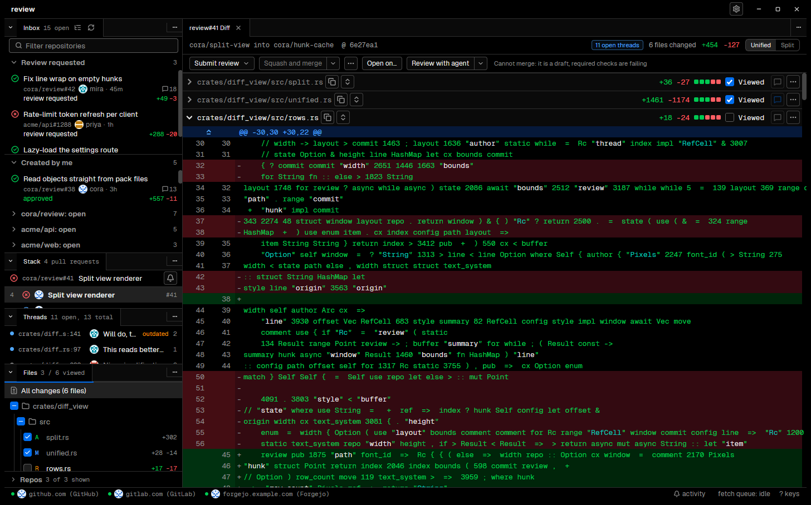

# review

A native desktop app for reviewing pull requests on GitHub, GitLab (merge
requests) and Forgejo, written in Rust on [gpui](https://github.com/zed-industries/zed)
and [gpui-component](https://github.com/longbridge/gpui-kit).



## What it does

- **Inbox**: the open pull requests across every configured forge, in
  sections: review requested from you, created by you, and one section per
  repository you list.
- **Diff view**: unified or split, syntax highlighted, read from local git
  objects. Review threads sit inline; you can reply, resolve, write and apply
  suggestions, mark files viewed, and queue comments to submit as one review
  with a verdict.
- **Conversation**: the description and timeline, reviewers, assignees and
  labels with pickers, and merge, auto-merge, close, reopen and draft toggles.
- **CI**: check status per pull request, the run, job and step tree, job logs
  with ANSI colors that tail a running job, and retry. You can watch a pull
  request or a run and get a system notification when it changes.
- **Terminals and worktrees** on this PC or on any `Host` of your
  `~/.ssh/config`, opened in the pull request's worktree. SSH goes through the
  system `ssh` binary.
- **Review with agent**: starts Claude Code in a terminal on the pull
  request's worktree, with a local MCP server whose tools turn its findings
  into draft comments marked "from Claude" (`add_review_comment`) and fill in
  the Submit review form with a suggested verdict and summary
  (`suggest_review`). Nothing is sent until you submit the review. The
  launch is restricted because a pull request's content is untrusted; see
  "Launch policy" in [docs/design.md](docs/design.md).
- **Themes**: Vercel dark and light (Geist), following the OS or fixed, plus
  your own theme files; interface and buffer fonts are configurable.

Every view is a dock panel that can be a tab or a split. The forge data is
cached in SQLite, so the inbox and open pull requests draw from cache first
and refresh in the background.

## Status

Early. Windows is the main tested platform. Linux builds and passes the
tests; the app needs a display there (Wayland or X11). macOS is not built or
tested.

Not every feature exists on every forge; the app hides what a forge cannot
do. The capability matrix is in [docs/design.md](docs/design.md), and planned
work is in [ROADMAP.md](ROADMAP.md).

## Building

You need a recent stable Rust (the workspace uses edition 2024; there is no
`rust-toolchain` file), [just](https://github.com/casey/just), and on Linux
the system libraries gpui links against.

```sh
just run      # debug build of the app (binary `review`)
just build    # debug build of the whole workspace
just run-release
```

To try the app without any forge account, run it on invented data:

```sh
cargo run -p app --bin review -- --fixtures
```

`--fixtures` keeps settings, layout and drafts in memory and does not touch
your config or data folders.

At runtime the app uses `git` (fetch and push), `ssh` for remote machines,
the forge CLIs below for sign-in, and `claude` for "Review with agent".

## Signing in

The app has no login screen and stores no token. It uses the forges' own
CLIs:

| Forge | CLI | Log in with |
|---|---|---|
| GitHub | `gh` | `gh auth login` |
| GitLab | `glab` | `glab auth login` |
| Forgejo | `fj` (forgejo-cli) | `fj auth login` |

On first run the app asks each CLI which hosts it is logged in to
(`gh auth status`, `glab auth status`, `fj auth list`) and writes a
`[[forges]]` entry for each. On later starts, a host a CLI newly reports is
appended; a host you delete from the file stays out. Tokens are read from the
CLIs at startup (for example `gh auth token`) and held in memory only.
Self-hosted GitLab and Forgejo instances work the same way.

## Configuration

`config.toml` lives in `review/` under your platform's config directory
(`%APPDATA%\review\config.toml` on Windows, `~/.config/review/config.toml` on
Linux). The first run writes it with comments that explain every field; the
template is `render` in [crates/app/src/config.rs](crates/app/src/config.rs).

- `[[forges]]`: `kind` (`github`, `gitlab` or `forgejo`), `host`, the inbox
  `sections` it feeds, and an optional `clone_url` template.
- `[[repos]]`: a repository with its own inbox section, optionally with an
  existing `clone` the app fetches into (it never checks out or moves HEAD
  there) or a `remote` URL. Without a clone the app keeps a bare repository
  under `data_dir`.
- `[[machines]]`: extras for this PC (`host = "local"`) or an SSH host: where
  clones live (`repos_root`, `clones`), the `command` "Open on machine" runs,
  and the `shell`.
- `[[workspaces]]`: where "Review with agent" runs for a repository: the
  machine, the repository's directory there, an optional working directory,
  the command, the first prompt, and `allow_commands` (off by default). The
  settings page edits these.

`settings.toml` beside it holds the theme, fonts, notification switches and
inbox options, and is written by the settings panel (`Ctrl+,`). Theme files
go in `themes/` beside it. The cache and app-owned repositories live in
`review/` under the platform's local data directory unless `data_dir` says
otherwise.

## Development

| Command | What it does |
|---|---|
| `just test` | `cargo test --workspace`, including the headless UI tests |
| `just check` | `cargo fmt --check`, clippy with warnings as errors, and `scripts/lint_literals.py` (no color, radius or font literals in views) |
| `just check-crate <crate>` | fmt and clippy for one crate |
| `just bench` | release-build timing benchmarks (diff scroll, dock, open, launch, theme switch, composer, log viewer, terminal, inbox, file list, store); each prints `PERF {json}` lines and must meet its budget. They open windows. `--only NAME` runs one. |
| `just live` | checks against real forge sandboxes (smoke, inbox, round trips, CI, notifications, a worktree on a remote machine); needs the `REVIEW_SANDBOX_*` variables, read from `.scratch/sandbox.env` when present. `--only NAME` runs one. |

`just bench` and `just live` run `scripts/checks.py` (Python 3) and write
each check's output to `.scratch/check-logs/`.

- [docs/design.md](docs/design.md): architecture, responsiveness rules, the
  forge layer and the per-forge API notes.
- [docs/testing.md](docs/testing.md): the headless UI test harness.
- [docs/sandboxes.md](docs/sandboxes.md): setting up the sandbox repositories
  the live checks write to, and recording forge fixtures.

## License

AGPL-3.0-or-later. See [LICENSE](LICENSE).

## Credits

- [gpui](https://github.com/zed-industries/zed) (as `gpui-pre`) by Zed
  Industries and [gpui-component](https://github.com/longbridge/gpui-kit)
  by Longbridge, both Apache-2.0.
- The [Geist and Geist Mono](https://github.com/vercel/geist-font) fonts
  (SIL Open Font License 1.1), in `crates/theme/assets/fonts`.
- Symbols Nerd Font Mono from [Nerd Fonts](https://github.com/ryanoasis/nerd-fonts)
  (MIT; the icon sets carry their own licenses), in
  `crates/term_view/assets/fonts`.
- Parts of the conversation and review-thread card UI are adapted from
  voximity/dispatch2 (AGPL-3.0); see
  the module docs of `crates/app/src/conversation.rs` and
  `crates/app/src/threads.rs`.
